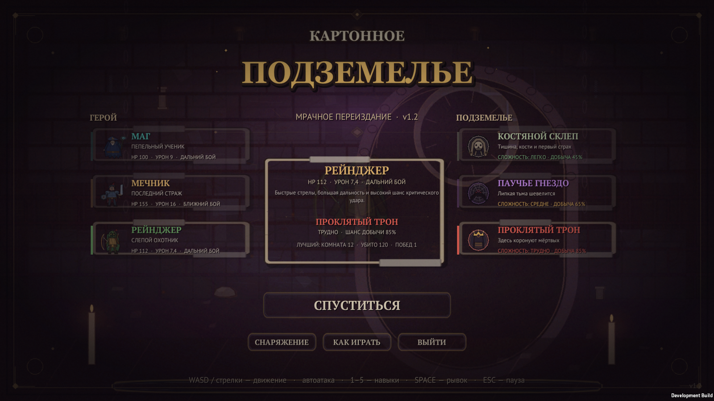
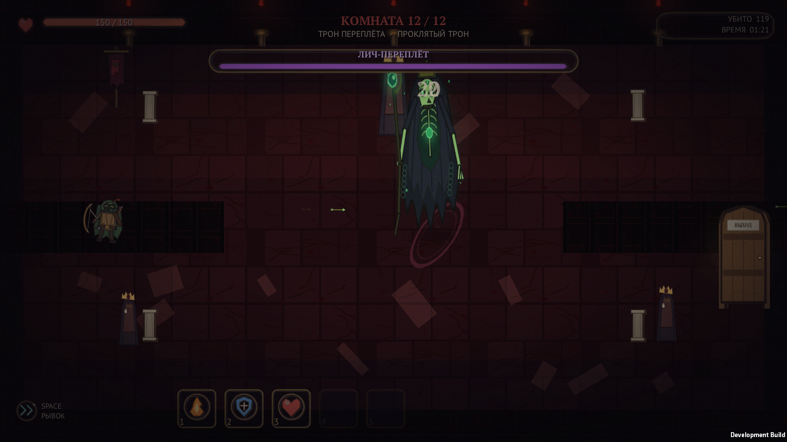
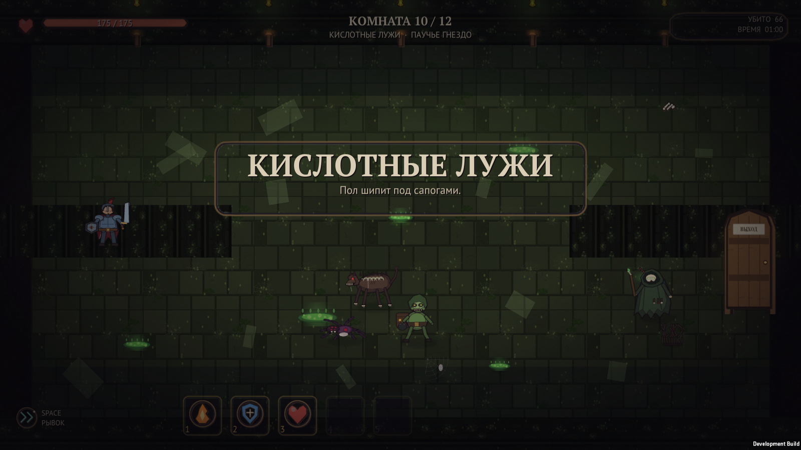
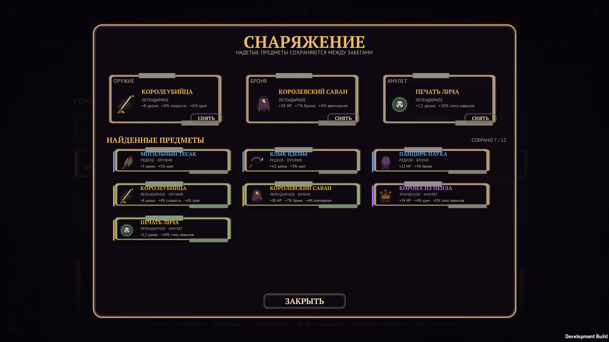
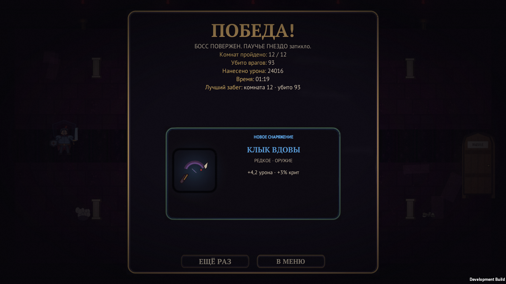

# Картонное подземелье

Top-down рогалик в духе Archero, собранный из плоских картонных вырезок. Герой сам атакует ближайшего врага, игрок управляет движением, рывком и активными навыками, а между волнами выбирает перки и спускается всё глубже. В v1.2 появились три класса, три подземелья, 36 комнат с собственным дизайном и случайное снаряжение.



## Что нового в v1.2

- **Три класса героя.** Маг бьёт тяжёлыми снарядами по площади, мечник — прочнее и рубит широкой дугой, рейнджер — быстрее всех и стреляет стрелами на большую дистанцию. Класс выбирается в главном меню и меняет стартовые статы, оружие и манеру боя.
- **Три подземелья.** «Костяной склеп» — лёгкий, «Паучье гнездо» — средний, «Проклятый трон» — трудный. У каждого свой пул врагов, босс, палитра, декор и награды.
- **36 комнат с уникальным дизайном.** У каждой комнаты собственное название, палитра пола и стен, цвет тумана и факелов, декор и центральный объект. Комната «Кислотные лужи» выглядит как затопленный ядом тоннель, «Зал коронации» — как тронный зал, а «Паучья колыбель» — как живое гнездо.
- **Случайное снаряжение.** После победы над боссом с шансом выпадает предмет: 45% в склепе, 65% в гнезде и 85% в троне. Чем выше сложность, тем лучше тир награды. Всего 12 предметов, 3 слота и 4 редкости — от обычных до легендарных.
- **Более мрачная графика.** Новые враги — призрак, палач, чумной доктор и гончая, три босса — Костяной король, Королева пауков и Лич-Переплёт. Больше тумана, углей, теней, цветных огней и жутких деталей.
- **Экран победы с добычей.** Карточка показывает иконку, редкость, слот и статы найденного предмета. Отдельно обрабатываются пустой сундук, полный арсенал и поражение.
- **Прогресс сохраняется.** Инвентарь, экипировка, выбранный класс, рекорды и число побед по каждому подземелью хранятся между запусками.

## Скачать

**[Скачать игру для Windows x64](https://github.com/mopchiktopchik2-cell/cardboard-dungeon/releases/download/v1.2/CardboardDungeon_v1.2_win64.zip)** — `CardboardDungeon_v1.2_win64.zip`, около 40 МБ.

> ⚠️ Не используйте зелёную кнопку **Code → Download ZIP**: это архив исходников без `.exe`. Готовая сборка лежит только в **Releases → Assets**.

- распакуйте архив целиком и дважды щёлкните **«Запустить игру»** (резервный вариант — `Запустить игру.bat`, можно запустить и сам `CardboardDungeon.exe`);
- ярлык портативный: он работает из любой папки, но должен лежать рядом с `CardboardDungeon.exe`;
- краткая памятка лежит в архиве: `КАК ЗАПУСТИТЬ.txt`;
- если Windows SmartScreen предупреждает, выберите «Подробнее» → «Выполнить в любом случае».

Ссылка на релиз: [v1.2](https://github.com/mopchiktopchik2-cell/cardboard-dungeon/releases/tag/v1.2). Сборки **v1.1** и **v1.0** остаются доступными в истории релизов.



## Управление

| Клавиша | Действие |
|---|---|
| `WASD` / стрелки | движение |
| Автоматически | атака ближайшего врага с учётом класса |
| `1`–`5` | активные навыки |
| `Space` | рывок с короткой неуязвимостью; пропуск анимации перехода |
| `Esc` | пауза |
| `R` | быстрый перезапуск на экране финала |

Совет: держите дистанцию, следите за телеграфами атак и не тратьте рывок впустую. Навыки сбрасывают перезарядку при входе в новую комнату.

## Что внутри



- 3 класса героя: маг, мечник и рейнджер.
- 3 подземелья по 12 комнат: бои, элитные арены, сокровищница, привал и босс.
- 36 именованных комнат с отдельными темами и декором.
- 14 видов врагов, включая трёх боссов с несколькими фазами.
- 12 активных навыков: огненный шар, щит, ледяная нова, цепная молния, лечение, яд, метеор и другие.
- 19 перков: урон, скорость атаки, пробитие, мультивыстрел, вампиризм, взрывные смерти, дополнительные слоты навыков.
- 12 предметов снаряжения в трёх слотах: оружие, броня и талисман.
- 4 редкости: обычная, редкая, эпическая и легендарная.
- Экран снаряжения с заменой предметов и пересчётом статов.
- Микроанимации ходьбы, атак, попаданий, телеграфов и рывка у игрока и врагов.
- Выбор из трёх карт после боя, отдельные экраны сокровищницы и привала.
- Постановочные переходы между комнатами и сохранение прогресса между запусками.
- Процедурная графика в стиле картонных вырезок и процедурный звук.

| Подземелье | Сложность | Босс | Шанс добычи |
|---|---|---|---|
| Костяной склеп | Легко | Костяной король | 45% |
| Паучье гнездо | Средне | Королева пауков | 65% |
| Проклятый трон | Трудно | Лич-Переплёт | 85% |





## Технологии

- **Unity 6000.6.6f1**, 2D, Built-in Render Pipeline.
- **UGUI**, старый Input Manager, Windows Standalone x64 (Mono).
- Вся сцена собирается кодом через `RuntimeInitializeOnLoadMethod`; в проекте одна сцена `Assets/Scenes/Game.unity`.
- Графика: `tools/gen_art.py`, `tools/gen_v11_art.py` и модульный `tools/gen_v12_art.py` (Python + Pillow), 151 PNG.
- Звук: `tools/gen_audio.py`, 26 WAV без сторонних сэмплов.
- Шрифты: PT Sans и PT Serif (ParaType, SIL OFL 1.1).

## Сборка из исходников

1. Установите Unity **6000.6.6f1** с модулем Windows Build Support.
2. Откройте папку проекта в Unity Hub.
3. Для сборки из командной строки:

```powershell
& "C:\Program Files\Unity\Hub\Editor\6000.6.6f1\Editor\Unity.exe" `
  -batchmode -quit `
  -projectPath "C:\путь\к\cardboard-dungeon" `
  -executeMethod Cardboard.EditorTools.ProjectSetup.BuildWindows `
  -logFile build.log
```

Результат: `Build/CardboardDungeon.exe`.

### QA-сборка

```powershell
& "C:\Program Files\Unity\Hub\Editor\6000.6.6f1\Editor\Unity.exe" `
  -batchmode -quit `
  -projectPath "C:\путь\к\cardboard-dungeon" `
  -executeMethod Cardboard.EditorTools.ProjectSetup.BuildQA `
  -logFile qa-build.log
```

Запуск: `Build\qa\CardboardDungeonQA.exe -qa`.

QA-клавиши: `F1`/`F2` — убить всех врагов, `F3` — лечение, `F4` — выдать перк, `F5` — скриншот, `F6` — следующее подземелье, `F7` — следующий класс, `F8` — перейти к боссу.

Автоматические прогоны для скриншотов:

```powershell
Build\qa\CardboardDungeonQA.exe -qa -qaTour -qaDungeon=throne -qaClass=ranger -qaShots=C:\shots
Build\qa\CardboardDungeonQA.exe -qa -qaEquip -qaShots=C:\shots
```

`-qaTour` проходит выбранное подземелье и сохраняет кадры всех комнат, меню, боя с боссом и экрана победы. `-qaEquip` открывает экран снаряжения с набором предметов.

### Self-tests

```powershell
& "C:\Program Files\Unity\Hub\Editor\6000.6.6f1\Editor\Unity.exe" `
  -batchmode -quit `
  -projectPath "C:\путь\к\cardboard-dungeon" `
  -executeMethod Cardboard.EditorTools.ProjectSetup.RunSelfTests `
  -logFile selftest.log
```

Проверяются данные контента, иконки, спрайты, шрифты, аудио, сложность, дроп и базовый баланс. Текущий результат: **1213 проверок, 0 ошибок**.

### Релизный архив

```powershell
powershell -ExecutionPolicy Bypass -File tools\package_release.ps1
```

Скрипт копирует в `Build` ярлык «Запустить игру» и памятку, собирает `CardboardDungeon_v1.2_win64.zip` без QA-сборки, логов и скриншотов и печатает размер и SHA256 архива.

## Структура

```
Assets/
  Editor/           настройка проекта, сборка, self-tests
  Resources/
    Art/            151 сгенерированный PNG
    Audio/          26 сгенерированных WAV
    Fonts/          PT Sans / PT Serif + OFL
  Scenes/Game.unity
  Scripts/
    Combat/         снаряды, навыки, опасности, союзники
    Core/           игра, данные, комнаты, прогресс, камера, аудио, self-tests
    Entities/       игрок, враги
    UI/             весь UGUI-интерфейс
    Visual/         картонные акторы, эффекты, мировые полоски здоровья
tools/              генераторы графики и звука, упаковка релиза
  launcher/         ярлык, .bat и памятка для релизного архива
docs/               скриншоты для README
```

## Лицензии

Сторонние игровые ассеты не используются. Подробности по графике, звуку и шрифтам: [ASSETS_LICENSES.md](ASSETS_LICENSES.md).

## Версия

`v1.2` — три класса, три подземелья, 36 комнат, случайное снаряжение и новая нечисть. История изменений: [CHANGELOG.md](CHANGELOG.md).
