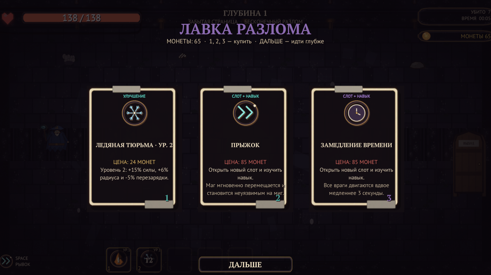

# Картонное подземелье

Top-down рогалик в духе Archero, собранный из плоских картонных вырезок. Герой сам атакует ближайшего врага, игрок управляет движением, рывком и активными навыками, а между волнами выбирает перки и спускается всё глубже. В v1.3 подземелья связаны цепочкой, у классов появились стартовые наборы навыков, а враги получили собственные приёмы и более умный обход препятствий. В v1.4 открылся отдельный «Бесконечный разлом»: процедурные комнаты, растущая сложность, монеты с врагов и лавка прокачки навыков. В v1.5 бой получил динамичную музыку, меню разбито на разделы, а разлом — на выбор класса и более щедрую экономику.


## Что нового в v1.5.0

- **Динамичная боевая музыка.** Для боёв добавлен отдельный трек `music_combat`: быстрый ритм, бас и арпеджио. Спокойная тема осталась в меню, а `music_boss` включается на боссах.
- **Меню по разделам.** Главный экран больше не смешивает всё: «Герои» открывают выбор класса, «Подземелья» — выбор забега, «Разлом» — отдельный экран с выбором класса и стартом. Возврат — «Назад» или `Esc`. Сводка текущего похода собрана в отдельную панель с портретом класса, статами, описанием, подземельем и версией `v1.5.0`.
- **Выбор класса в разломе.** Бесконечный режим стартует с выбранным классом: маг, мечник или рейнджер. Стартовые навыки и внешний вид соответствуют выбору.
- **Класс забега фиксируется.** Стиль атаки, стартовые навыки, перки и лавка привязаны к классу, выбранному при старте; мечник в разломе больше не сбивается на стрелы.
- **Щедрее экономика.** Стартовый капитал — 40 монет; обычные враги дают 2–4 монеты плюс `depth / 4`, элита — `8 + depth / 2`, босс — `30 + 2·depth`, за зачистку комнаты — ещё `5 + depth`. Прокачка успевает за ростом сложности.
- **Мягче сложность.** HP врагов растёт по `1 + 0.085·depth + 0.0012·depth²`, урон — по `1 + 0.045·depth + 0.0004·depth²`; на глубине 10 это заметно мягче прежнего.

## Что нового в v1.4.0

- **Бесконечный разлом.** Отдельный режим, не связанный с сюжетной цепочкой подземелий. Комнаты, темы и составы волн собираются процедурно, а сложность растёт с глубиной. Босс встречается каждые 5 комнат, на дне ждёт финальный босс.
- **Монеты и лавка.** С обычных врагов выпадает 1–2 монеты, с элиты — больше, с босса — ещё больше. Стартовый капитал — 25 монет. После каждой комнаты открывается лавка: улучшения навыков, новые навыки, перки, лечение и постоянные прибавки к характеристикам.
- **Прокачка навыков.** У каждого из 16 навыков пять уровней. Уровни увеличивают урон, радиус и длительность, а также снижают перезарядку. Навык можно докупить в лавке, даже если он уже есть в слоте.
- **Mastery-эффекты.** На пятом уровне навык получает особый механический эффект, а не только прибавку к цифрам: огненный шар выпускает три снаряда, щит отражает урон, ледяная тюрьма замораживает всех врагов, лечение снимает яд и оглушение, блинк оставляет взрывы, а голем призывает второго союзника.
- **Рекорды разлома.** Лучшая глубина, убийства и собранные монеты сохраняются между запусками и показываются в меню.



## Что нового в v1.3.2

- **Классовые наборы разделены.** У мага только магические навыки и перки, у мечника — рыцарские, у рейнджера — рейнджерские. Общими остались лечение, голем и базовые перки.
- **Крупный HUD.** Полоса HP увеличена до `380×40`, сердце — до 58 px, текст HP — 30 px bold. Атмосферные затемнения больше не перекрывают здоровье и панель навыков.
- **Заметные снаряды.** Добавлены glow-подсветка, более яркий цвет, выразительный след и отдельные цвета для вражеских снарядов.
- **Новый переход между комнатами.** Двухслойный бумажный занавес с золотой кромкой, вспышка, тряска камеры, пыль и кольцо у двери.
- **Собаки стали ближними бойцами.** Они сближаются и кусают с замахом, а прыжок получил длинный телеграф и урон только после приземления.
- **Лечение после перехода.** После входа в следующую комнату восстанавливается 20% максимального HP.

## Что нового в v1.3.1

- **Исправлен выбор подземелья в меню.** Раньше все три карточки могли отправлять к последнему индексу, из-за чего «Костяной склеп» не открывался и появлялось сообщение про «Проклятый трон». Теперь каждая карточка выбирает своё подземелье.
- **Защита от некорректного индекса.** Меню игнорирует несуществующее подземелье вместо ошибочного перехода и ложной блокировки.
- **Настройки в меню и паузе.** Разрешение, частота кадров, полноэкранный режим и громкость сохраняются между запусками. Сброс прогресса требует повторного подтверждения.
- **Исправлены гонки после смерти босса.** Победа не срабатывает после перезапуска или выхода в меню, урон игроку блокируется на время задержки победы, а пауза больше не открывается после смерти босса. Если игрок погиб раньше, засчитывается поражение.
- **Меньше «залипших» атак и снарядов.** Атаки врагов останавливаются после смерти, дальние атаки не проходят сквозь стены, а снаряды и лужи убираются при зачистке комнаты и переходах.
- **У боссов больше приёмов.** У каждого босса теперь шесть паттернов: четыре общих и две уникальные атаки. Костяной король добавляет костяной веер и королевский рывок, Королева пауков — ядовитый веер и паутину с ядом и замедлением, Лич-Переплёт — спираль душ и луч души.
- **Запуск без ярлыка.** В архиве больше нет `.lnk`: игра запускается через `Запустить игру.bat` или `CardboardDungeon.exe`.

## Что нового в v1.3

- **Цепочка подземелий.** Сначала открыт только «Костяной склеп». Победа открывает следующее подземелье: «Паучье гнездо», затем «Проклятый трон». Закрытые карточки в меню заблокированы, а после победы можно сразу спуститься дальше кнопкой **«СЛЕДУЮЩЕЕ»** или клавишей `N`.
- **Стартовые наборы классов.** Маг начинает с огненным шаром и ледяной тюрьмой, мечник — со щитом и круговым ударом, рейнджер — с семью стрелами и теневым бегом.
- **Щит — способность рыцаря.** Только мечник получает щит: барьер на 30% максимального HP, который держится 5 секунд. Другим классам щит не выпадает, а перк «Бумажный барьер» доступен только рыцарю.
- **Ледяная тюрьма.** Замораживает врагов вокруг мага на 2 секунды и суммарно наносит 20% их максимального HP. Перезарядка — 15 секунд.
- **Семь стрел.** Рейнджер выпускает 7 самонаводящихся стрел по ближайшим врагам. Перезарядка — 8 секунд.
- **Теневой бег.** 3 секунды неуязвимости; рейнджер может стрелять на бегу. Перезарядка — 9 секунд.
- **Круговой удар.** Мечник на мгновение замирает и бьёт всех вокруг с повышенным уроном. Перезарядка — 8 секунд.
- **Уникальные атаки врагов.** Страж разгоняется и станит — от рывка можно уклониться; паук плюёт паутиной и замедляет; чумной доктор оставляет ядовитые лужи; гончая совершает прыжок; скелет стреляет тройным залпом; палач бьёт по площади; призрак телепортируется и выпускает веер душ; шаман лечит союзников, а бомбер взрывается. У боссов свои телеграфы и фазовые атаки.
- **Умнее навигация.** Враги обходят препятствия, пробуют альтернативные направления и выбираются из застревания, а не толпятся в стене.
- **Читаемая картинка.** Пол, стены и декор стали светлее, тёмные оверлеи ослаблены, а щит отображается синим сегментом поверх правой части полосы HP.
- **Больше слотов навыков.** После перка «Новый слот» сначала открывается дополнительный слот, затем предлагается новое умение. Перк можно брать повторно — всего доступно до 5 слотов.
- **Баланс.** Вампиризм даёт +3% за перк с потолком 12%, лечение от него ограничено, а щит и заморозка стали заметно слабее и требуют более аккуратного использования.

## Скачать

**[Скачать игру для Windows x64](https://github.com/mopchiktopchik2-cell/cardboard-dungeon/releases/download/v1.5.0/CardboardDungeon_v1.5.0_win64.zip)** — `CardboardDungeon_v1.5.0_win64.zip`, около 40 МБ.

> ⚠️ Не используйте зелёную кнопку **Code → Download ZIP**: это архив исходников без `.exe`. Готовая сборка лежит только в **Releases → Assets**.

- распакуйте архив целиком и дважды щёлкните **«Запустить игру.bat»** или сам `CardboardDungeon.exe`;
- `.bat` и `.exe` должны лежать в одной папке с `CardboardDungeon_Data`; сам архив можно распаковать в любую папку;
- краткая памятка лежит в архиве: `КАК ЗАПУСТИТЬ.txt`;
- если Windows SmartScreen предупреждает, выберите «Подробнее» → «Выполнить в любом случае».

Ссылка на релиз: [v1.5.0](https://github.com/mopchiktopchik2-cell/cardboard-dungeon/releases/tag/v1.5.0). Сборки **v1.4.0**, **v1.3.2**, **v1.3.1**, **v1.3**, **v1.2**, **v1.1** и **v1.0** остаются доступными в истории релизов.


## Управление

| Клавиша | Действие |
|---|---|
| `WASD` / стрелки | движение |
| Автоматически | атака ближайшего врага с учётом класса |
| `1`–`5` | активные навыки |
| `1`–`3` в лавке | купить предложение; `Enter`/`Space` — «ДАЛЬШЕ» |
| `Space` | рывок с короткой неуязвимостью; пропуск анимации перехода |
| `Esc` | пауза; в настройках — закрыть настройки |
| `N` | следующее подземелье на экране победы |
| `R` | быстрый перезапуск на экране финала |

Настройки открываются кнопкой **«НАСТРОЙКИ»** в главном меню и в паузе.

Совет: держите дистанцию, следите за телеграфами атак и не тратьте рывок впустую. Маг и рейнджер не атакуют на бегу — остановитесь для выстрела или используйте «Теневой бег». Навыки сбрасывают перезарядку при входе в новую комнату.

## Что внутри


- 3 класса героя со своими стартовыми навыками: маг, мечник и рейнджер.
- Отдельный «Бесконечный разлом»: процедурные комнаты, растущая сложность, босс каждые 5 комнат и финальный босс на дне.
- Монеты с врагов, лавка после каждой комнаты и пять уровней прокачки для каждого из 16 навыков.
- Mastery-эффекты на максимальном уровне навыка: дополнительные снаряды, отражение урона, массовая заморозка, очищение от статусов и другие механические бонусы.
- 3 подземелья по 12 комнат, открывающихся по цепочке: бои, элитные арены, сокровищница, привал и босс.
- 36 именованных комнат с отдельными темами и декором.
- 14 видов врагов, включая трёх боссов с несколькими фазами и шестью паттернами атак: четыре общих и две уникальные.
- 16 активных навыков: огненный шар, щит рыцаря, ледяная тюрьма, семь стрел, теневой бег, круговой удар, цепная молния, метеор и другие.
- 19 перков: урон, скорость атаки, пробитие, мультивыстрел, вампиризм, взрывные смерти, дополнительные слоты навыков.
- До 5 слотов навыков: перк «Новый слот» сначала расширяет панель, затем предлагает выбрать новое умение.
- 12 предметов снаряжения в трёх слотах: оружие, броня и талисман.
- 4 редкости: обычная, редкая, эпическая и легендарная.
- Экран снаряжения с заменой предметов и пересчётом статов.
- Микроанимации ходьбы, атак, попаданий, телеграфов и рывка у игрока и врагов.
- Выбор из трёх карт после боя, отдельные экраны сокровищницы и привала.
- Постановочные переходы между комнатами и сохранение прогресса между запусками.
- Процедурная графика в стиле картонных вырезок и процедурный звук.

| Подземелье | Сложность | Босс | Шанс добычи |
|---|---|---|---|
| Костяной склеп | Легко | Костяной король | 45% |
| Паучье гнездо | Средне | Королева пауков | 65% |
| Проклятый трон | Трудно | Лич-Переплёт | 85% |


## Технологии

- **Unity 6000.6.6f1**, 2D, Built-in Render Pipeline.
- **UGUI**, старый Input Manager, Windows Standalone x64 (Mono).
- Вся сцена собирается кодом через `RuntimeInitializeOnLoadMethod`; в проекте одна сцена `Assets/Scenes/Game.unity`.
- Графика: `tools/gen_art.py`, `tools/gen_v11_art.py` и модульный `tools/gen_v12_art.py` (Python + Pillow), 152 PNG.
- Звук: `tools/gen_audio.py`, 27 WAV без сторонних сэмплов.
- Шрифты: PT Sans и PT Serif (ParaType, SIL OFL 1.1).

## Сборка из исходников

1. Установите Unity **6000.6.6f1** с модулем Windows Build Support.
2. Откройте папку проекта в Unity Hub.
3. Для сборки из командной строки:

```powershell
& "C:\Program Files\Unity\Hub\Editor\6000.6.6f1\Editor\Unity.exe" `
  -batchmode -quit `
  -projectPath "C:\путь\к\cardboard-dungeon" `
  -executeMethod Cardboard.EditorTools.ProjectSetup.BuildWindows `
  -logFile build.log
```

Результат: `Build/CardboardDungeon.exe`.

### QA-сборка

```powershell
& "C:\Program Files\Unity\Hub\Editor\6000.6.6f1\Editor\Unity.exe" `
  -batchmode -quit `
  -projectPath "C:\путь\к\cardboard-dungeon" `
  -executeMethod Cardboard.EditorTools.ProjectSetup.BuildQA `
  -logFile qa-build.log
```

Запуск: `Build\qa\CardboardDungeonQA.exe -qa`.

QA-клавиши: `F1`/`F2` — убить всех врагов, `F3` — лечение, `F4` — выдать перк, `F5` — скриншот, `F6` — следующее подземелье, `F7` — следующий класс, `F8` — перейти к боссу.

Автоматические прогоны для скриншотов:

```powershell
Build\qa\CardboardDungeonQA.exe -qa -qaTour -qaDungeon=throne -qaClass=ranger -qaShots=C:\shots
Build\qa\CardboardDungeonQA.exe -qa -qaTour -qaDungeon=crypt -qaClass=mage -qaNext -qaShots=C:\shots
Build\qa\CardboardDungeonQA.exe -qa -qaEquip -qaShots=C:\shots
Build\qa\CardboardDungeonQA.exe -qa -qaSettingsShot -qaShots=C:\shots
Build\qa\CardboardDungeonQA.exe -qa -qaAudit
Build\qa\CardboardDungeonQA.exe -qa -qaBossAttacks
Build\qa\CardboardDungeonQA.exe -qa -qaEndless -qaShots=C:\shots
Build\qa\CardboardDungeonQA.exe -qa -qaMenuPages -qaShots=C:\shots
```

`-qaTour` проходит выбранное подземелье, использует стартовые навыки класса и сохраняет кадры всех комнат, меню, боя с боссом и экрана победы. `-qaNext` дополнительно проверяет переход к следующему подземелью. `-qaEquip` открывает экран снаряжения с набором предметов, `-qaSettingsShot` — экран настроек. `-qaAudit` проверяет гонку победы после смерти босса, блокировку урона и паузы, очистку снарядов и лужа, приоритет поражения, попадания вражеских снарядов, укус собаки и лечение 20% при переходе. `-qaBossAttacks` принудительно запускает все шесть паттернов у каждого босса и проверяет, что каждый стартует. `-qaEndless` проходит первые комнаты разлома, проверяет монеты, лавку, покупку, mastery и босса. `-qaMenuPages` открывает «Герои», «Подземелья» и «Разлом», делает скриншоты и проверяет, что разлом стартует с выбранным классом.

### Self-tests

```powershell
& "C:\Program Files\Unity\Hub\Editor\6000.6.6f1\Editor\Unity.exe" `
  -batchmode -quit `
  -projectPath "C:\путь\к\cardboard-dungeon" `
  -executeMethod Cardboard.EditorTools.ProjectSetup.RunSelfTests `
  -logFile selftest.log
```

Проверяются данные контента, иконки, спрайты, шрифты, аудио, сложность, дроп, классовые ограничения навыков, настройки экрана, бесконечный режим и базовый баланс. Текущий результат: **1703 проверки, 0 ошибок**.

### Релизный архив

```powershell
powershell -ExecutionPolicy Bypass -File tools\package_release.ps1
```

Скрипт копирует в `Build` файл `Запустить игру.bat` и памятку, удаляет старые `.lnk`, собирает `CardboardDungeon_v1.5.0_win64.zip` без QA-сборки, логов, скриншотов и ярлыков и печатает размер и SHA256 архива.

## Структура

```
Assets/
  Editor/           настройка проекта, сборка, self-tests
  Resources/
    Art/            152 сгенерированных PNG
    Audio/          27 сгенерированных WAV
    Fonts/          PT Sans / PT Serif + OFL
  Scenes/Game.unity
  Scripts/
    Combat/         снаряды, навыки, опасности, союзники
    Core/           игра, данные, комнаты, прогресс, камера, аудио, self-tests
    Entities/       игрок, враги
    UI/             весь UGUI-интерфейс
    Visual/         картонные акторы, эффекты, мировые полоски здоровья
tools/              генераторы графики и звука, упаковка релиза
  launcher/         .bat и памятка для релизного архива
docs/               скриншоты для README
```

## Лицензии

Сторонние игровые ассеты не используются. Подробности по графике, звуку и шрифтам: [ASSETS_LICENSES.md](ASSETS_LICENSES.md).

## Версия

`v1.5.0` — динамичная боевая музыка, раздельное меню «Герои / Подземелья / Разлом», выбор класса в бесконечном режиме и более щедрая экономика с мягче растущей сложностью. Сюжетные подземелья, их 12 комнат и три босса не изменились. История изменений: [CHANGELOG.md](CHANGELOG.md).
